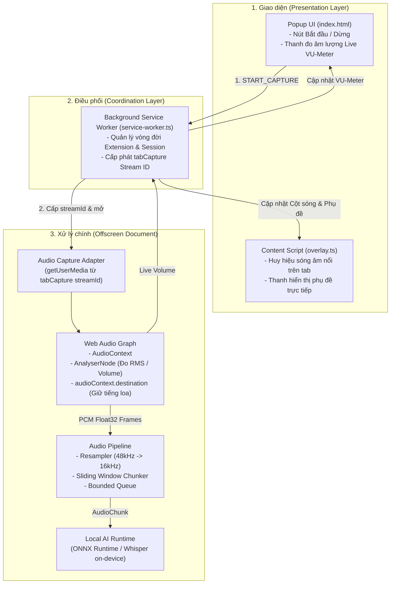

# ClearVoice 🎙️

> **A local-first browser tab audio capture, streaming processing, and real-time AI transcription extension.**

[](https://www.typescriptlang.org/)
[](https://developer.chrome.com/docs/extensions/)
[](https://vitejs.dev/)
[]()

ClearVoice là một Chrome Extension cho phép người dùng thu âm thanh từ bất kỳ tab trình duyệt nào (YouTube, Google Meet, Zoom Web...), xử lý tín hiệu âm thanh theo luồng (streaming) và nhận diện giọng nói (ASR) bằng mô hình AI chạy trực tiếp trên thiết bị (on-device).

Dự án được thiết kế theo triết lý **Local-First & Privacy-First**:
* 🛡️ **Bảo mật tuyệt đối:** Không gửi bất kỳ byte âm thanh nào lên cloud server.
* ⚡ **Zero Cloud Cost:** Sử dụng 100% tài nguyên CPU/WebGPU của máy người dùng.
* 🎧 **Trải nghiệm mượt mà:** Tab vẫn phát âm thanh bình thường ra loa trong lúc thu âm; phụ đề nổi trực tiếp trên video.

---

## 🏛️ Kiến trúc Hệ thống (System Architecture)

Do các ranh giới khắt khe của **Chrome Extension Manifest V3 (MV3)**, hệ thống được phân tách thành 4 thành phần tách biệt nhưng kết nối chặt chẽ:



---

## 📂 Cấu trúc Thư mục (Project Layout)

```text
ClearVoice/
├── documents/                   # Tài liệu thiết kế kỹ thuật & lộ trình học tập
│   ├── README_01_LEARNING_PREREQUISITES.md # Kiến thức nền tảng (DSP, MV3, Streaming)
│   ├── README_02_SYSTEM_ARCHITECTURE.md    # Thiết kế kiến trúc chi tiết
│   └── README_03_PROJECT_CONTEXT_FOR_AI.md # Quy chuẩn kỹ thuật & tiêu chí nghiệm thu
├── public/
│   └── manifest.json            # Cấu hình Chrome Extension Manifest V3
├── src/
│   ├── types/
│   │   ├── audio.ts             # Hợp đồng dữ liệu AudioChunk & TranscriptSegment
│   │   └── messages.ts          # Typed Messages cho Message Bus nội bộ
│   ├── background/
│   │   └── service-worker.ts    # Tổng đài điều phối session và quyền tab
│   ├── popup/                   # Giao diện điều khiển & Live Volume Meter
│   │   ├── index.html
│   │   ├── popup.css
│   │   └── popup.ts
│   ├── offscreen/               # Trang ngầm Web Audio API & Xử lý tín hiệu
│   │   ├── offscreen.html
│   │   └── offscreen.ts
│   └── content/                 # Live Subtitle Overlay & Live Badge trên tab
│       ├── overlay.css
│       └── overlay.ts
├── package.json
├── tsconfig.json                # TypeScript cấu hình nghiêm ngặt (strict mode)
└── vite.config.ts               # Cấu hình Vite bundle đa entrypoint cho MV3
```

---

## 📊 Hợp đồng Dữ liệu Cốt lõi (Data Contracts)

Theo đặc tả kỹ thuật, dữ liệu âm thanh số và phụ đề được định nghĩa chặt chẽ để đảm bảo tính toàn vẹn:

### 1. `AudioChunk`
```typescript
interface AudioChunk {
  sessionId: string;             // ID phiên thu âm duy nhất
  sequence: number;              // Số thứ tự tăng dần (phát hiện mất gói)
  startSample: number;           // Vị trí mẫu âm thanh trong dòng thời gian
  sampleRate: number;            // Tần số lấy mẫu (16000 Hz)
  channels: number;              // Kênh âm thanh (1 = Mono)
  format: "f32";                 // Định dạng Float32Array [-1.0, 1.0]
  samples: Float32Array;         // Dữ liệu sóng âm thô
  capturedAtMonotonicMs: number; // Mốc thời gian đơn điệu (performance.now())
}
```

### 2. `TranscriptSegment`
```typescript
interface TranscriptSegment {
  id: string;                    // ID phân đoạn chữ
  sessionId: string;
  startMs: number;               // Khớp theo timeline âm thanh (không bịa)
  endMs: number;
  text: string;                  // Nội dung nhận diện
  status: "partial" | "final";   // Trạng thái dự đoán / đã chốt
}
```

---

## 🚀 Hướng dẫn Cài đặt & Chạy thử nghiệm

### 1. Yêu cầu Môi trường
* **Node.js**: Phiên bản `v18.0.0` trở lên (Khuyến nghị Node 20 hoặc 22)
* **npm**: Phiên bản `9.0.0` trở lên
* **Trình duyệt**: Google Chrome, Brave, Microsoft Edge hoặc các trình duyệt Chromium hỗ trợ MV3

### 2. Cài đặt Dependencies & Biên dịch
```bash
# Clone dự án (nếu tải từ git)
git clone https://github.com/your-username/ClearVoice.git
cd ClearVoice

# Cài đặt thư viện
npm install

# Biên dịch mã nguồn ra thư mục dist/
npm run build

# (Tuỳ chọn) Chạy chế độ watch tự động build khi sửa code:
npm run dev
```

### 3. Nạp Extension vào Trình duyệt Chrome
1. Mở trình duyệt Chrome và truy cập: `chrome://extensions`
2. Bật công tắc **Developer mode** (Chế độ dành cho nhà phát triển) ở góc trên bên phải.
3. Bấm nút **Load unpacked** (Tải tiện ích đã giải nén).
4. Chọn thư mục `dist` bên trong thư mục dự án `ClearVoice/dist`.
5. Tiện ích **ClearVoice** sẽ xuất hiện trên thanh công cụ của bạn.

### 4. Kiểm thử Chức năng
1. Mở một tab bất kỳ có phát âm thanh (ví dụ một video YouTube).
2. Bấm vào icon **ClearVoice** trên thanh Extension của Chrome.
3. Bấm **"Bắt đầu thu âm Tab"**:
   * Quan sát thanh **Tín hiệu âm thanh (VU-Meter)** trên Popup nhảy theo điệu nhạc.
   * Quan sát huy hiệu nổi **`ClearVoice Audio`** ở góc trên bên phải video YouTube.
   * Thử bấm tạm dừng (Pause) video YouTube -> Tín hiệu âm lượng lập tức tụt về `0%`.
4. Bấm **"Dừng thu âm"** để giải phóng tài nguyên.

---

## 🗺️ Lộ trình Phát triển (Milestones)

- [x] **Milestone 0:** Khởi tạo bộ khung dự án (Vite + TypeScript + Manifest V3) & Git workflow.
- [x] **Milestone 1:** Tab Audio Capture & Live RMS Volume Streaming (Web Audio API, AnalyserNode).
- [x] **Milestone 2:** Audio Processing Pipeline (AudioWorklet, Resampling 48kHz -> 16kHz Mono, Sliding Window Chunker 3s/1s hop, Bounded Ring Buffer Queue, Energy VAD Filter).
- [x] **Milestone 3:** Local AI Runtime Integration (Transformers.js v3, ONNX Runtime Web, onnx-community/whisper-tiny on-device WebGPU/WASM).
- [ ] **Milestone 4:** Live Subtitle Overlay & Transcript Stabilization Engine (Khử lặp từ, đồng bộ timeline).
- [ ] **Milestone 5:** Benchmarking (Latency P50/P95, CPU, RAM) & Release v1.0.

---

## 📚 Tài liệu Chi tiết
Các tài liệu phân tích kỹ thuật chuyên sâu nằm trong thư mục `documents/`:
* [Lộ trình Kiến thức Cần học](documents/README_01_LEARNING_PREREQUISITES.md)
* [Đặc tả Kiến trúc Hệ thống](documents/README_02_SYSTEM_ARCHITECTURE.md)
* [Ngữ cảnh Dự án & Tiêu chuẩn Kỹ thuật](documents/README_03_PROJECT_CONTEXT_FOR_AI.md)

---

## 📄 License
Dự án được phát triển cho mục đích học tập kỹ thuật hệ thống, portfolio cá nhân và nghiên cứu công nghệ Local-first AI.
